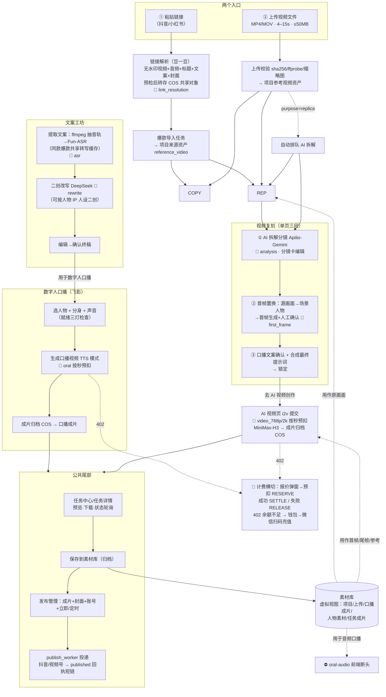
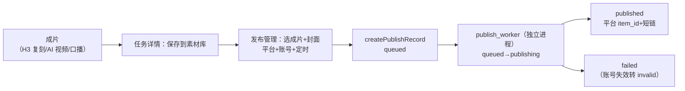

# 真实业务流程全景梳理 —— "上传视频 / 输入链接"两大入口的端到端流程图

> 日期：2026-09-21。口径：以当前 main 代码实测为准（前端 `client/src/studio/`，后端 `server/app/`），既有文档（`docs/前后端页面功能与接口匹配梳理-2026-09-18.md` 等）仅作交叉核对。
> 记号：💸 = 计费扣费点；⛔ = 断点/未接线/待授权；💵 后端支持但收费为 0。
>
> **2026-10-14 更新**（对照 [前后端业务逻辑对照与缺陷排查-2026-10-13](前后端业务逻辑对照与缺陷排查-2026-10-13.md) 整改）：
> 爆款「查看详情」已免费；「获取文案」口径为转写者本人免费、非转写者首次扣一次；独立创作扩展模式总开关已不存在
> （t2v/i2v/r2v 均开放，仅 l2v 仍由前端禁用）；爆款卡片/详情已有「去复刻」入口。下文表格与断点清单据此改写。

---

## 0. 全局硬约束（所有入口共享）

| 约束 | 值 | 代码证据 |
|---|---|---|
| 参考视频时长 | **4–15 秒**（上传与链接解析同一上限，超限 422 `VIDEO_DURATION_OUT_OF_RANGE` / `VIRAL_LINK_DURATION_EXCEEDED`） | `server/app/media.py:44,723`、`server/app/viral_import_routes.py:56` |
| 上传大小/格式 | ≤50MB，仅 MP4/MOV | `server/app/media.py:41-43` |
| 链接平台 | 仅抖音、小红书；**视频号链接 422 不支持**（视频号内容只能上传 MP4 或经平台周采集入库） | `server/app/viral_link.py`（`WECHAT_CHANNELS_LINK_UNSUPPORTED`） |
| 供应商 | 拆解/首帧/人物图=Apilio、文案提取=DashScope Fun-ASR、改写=DeepSeek、口播=飞影 Hifly、H3 生成=metaso MiniMax-H3、链接解析=豆一豆、采集=TikHub；生产环境禁用一切 fake provider | `server/app/billing_catalog.py` |

---

## 1. 一次性资产准备（流程前置，不属于两大入口，但流程依赖）

| 资产 | 用户操作 | 链路 | 计费 |
|---|---|---|---|
| 人物库人物 | 人物库→创建人物（上传授权图）→生成五视图拼合图→维护 IP 定位 | `character_routes.py`、`character_generation_routes.py` | 💸 character（按张） |
| 口播分身 | 人物库→分身 Tab→上传真人视频+勾选授权书→克隆→ready 后"使用此分身" | `POST /api/oral/avatars`（飞影） | 💸 avatar_clone（1 次） |
| 克隆声音 | 人物库→声音 Tab→上传样本+授权→克隆→试听→确认→"使用此声音" | `POST /api/oral/voices`、`/voices/{id}/confirm` | 💸 voice_clone（1 次） |
| 发布账号 | 个人中心→发布账号→扫码连接（本机 WebView 导出登录态）或 cookie 导入→平台账号入库 | `publish_routes.py`、`publish_browser_routes.py` | 免费 |

---

## 2. 全景总图

---

## 3. 入口 A：粘贴爆款链接

**公共前段**（工作台输入框，`client/src/studio/MainPages.tsx:649-708`）：
1. 粘贴链接 → `POST /api/viral/link-resolutions`（幂等键）：规范化链接→豆一豆解析出**无水印视频直链+音频+标题+作者+封面+文案文本**→时长/内容预检→视频转存 COS（`viral/{platform}/{video_id}.mp4`，共享不可变对象）→ `viral_videos` 入库。💸 link_resolution
2. `POST /api/viral/videos/import-tasks` 建**导入任务**（PENDING→RUNNING→SUCCEEDED）→ worker 把共享视频钉住（pinned）并挂为项目 `reference_video` 来源资产。
3. 此后按用户意图分叉：

### F1 链接 → 口播数字人成片（用户举例的完整流程）

要点：
- 声音/分身克隆是一次性资产（见 §1），首次做口播会先被引导去人物库制作。
- 后端状态机：`QUEUED → SUBMITTING → RUNNING → ARCHIVING → SUCCEEDED`，旁路 `SUBMISSION_UNCERTAIN / FAILED / CANCELLED / ARCHIVE_FAILED`（`server/app/oral_routes.py`、`oral_worker.py`）。
- 计费：预扣→`SETTLE`（成功）/`RELEASE`（失败退回）；402 `INSUFFICIENT_CREDITS` → 前端直接打开钱包侧栏→微信扫码充值。

### F2 链接 → 视频复刻成片

要点：
- 复刻是**单页三段式**（拆解→首帧→文案与生成），不是多页跳转（`client/src/studio/CreationPages.tsx:1236` ReplicaPage）。
- **硬前置**：批次生成要求"提示词已锁定 + 首帧已人工确认"（`server/app/generation.py`），所以复刻必经首帧置换。
- 实际生成动线已改为"复刻页 → AI 视频页（独立任务 `/api/independent/video-tasks`）"承接；旧的"复刻一键生成"后端仍在但前端已无入口。
- 拆解产物（分镜表）可"保存为自定义"进"我的提示词"，供独立创作复用。

### F3 链接 → 仅产出文案（短流程）

链接解析 → 导入 → ASR 提取（💸）→ 文案工坊。此后可：直接确认终稿（不二创）、二创后确认（💸 rewrite）、保存到"我的文案"。出口仍是口播或止步于文案。

### 变体：爆款视频库（平台周采集，免贴链接）

爆款视频页内容来自管理端配置关键词的 **TikHub 周采集**（抖音+视频号，近 7 天，💸 viral_data 按激活用户摊收），入库 `viral_videos`。卡片动作只有：**查看详情 / 提取文案 / 收藏**——提取文案走与 F1 相同的 ASR 链（同款爆款共享转写缓存，只付费一次）。卡片与详情页已有"去复刻"入口（4–15 秒视频）；仍没有"去口播/存素材库"按钮。「查看详情」**免费**（不再扣 `viral_detail`，资费配置不影响打开详情）。

---

## 4. 入口 B：上传视频文件

**公共前段**（工作台上传图标 / 复刻页"上传参考视频"）：`upload-intent` → COS 预签名 PUT → `complete`（GET 读回+sha256+ffprobe 校验 4–15s+缩略图）→ 项目 `reference_video` 资产。复刻页上传（purpose=replica）会**自动排队拆解任务**；工作台上传（purpose=script）需用户再点按钮。

### F4 上传 → 文案 → 口播（自有视频版 F1）
工作台上传 → 点"提取文案" → 同 F1 的 ASR 之后全链（文案工坊→终稿→口播→归档→发布）。

### F5 上传 → 复刻（自有视频版 F2）
复刻页上传（自动拆解）或工作台上传后点"开始复刻" → 同 F2 全链。

> 上传入口还散落在资产环节：素材库"上传素材"（material_image/audio/video）、人物库分身源视频、克隆声音样本、发布自定义封面——它们不进入创作主链，属 §1 资产准备或素材补给。

---

## 5. 横向流程（不依赖两大入口，或作为其延伸）

### F6 独立创作（AI 视频页，无参考视频起点）

| 模式 | 输入 | 状态 |
|---|---|---|
| i2v 图生视频 | 首帧图（素材库/复刻接力/上传）+提示词（可导入"我的提示词"/分镜表） | ✅ 已开放 |
| t2v 文生视频 | 纯提示词 | ✅ 已开放（能力接口 `/api/independent/capabilities` 全部返回开放；旧的扩展模式总开关已移除） |
| r2v 参考生视频 | 参考素材混合（图≤8/视≤3/音≤3，以能力接口为准；视频、音频各自累计≤15 秒） | ✅ 已开放 |
| l2v 仅尾帧 | 尾帧图 | ⛔ 前端提交硬禁用（"仅尾帧生成尚待验证"） |

动线：AI 视频页 → 参数（768P/2K、4–15s、比例、数量 1/2/4）→ 报价确认弹窗 → 提交 → 页内进度视图 → 查看成片 → 任务中心。复用复刻同一 worker/队列/计费管线（`server/app/independent.py`）。

### F7 素材库再创作（成片与素材的复用闭环）

素材库是**虚拟视图**（`server/app/materials.py`），五种来源：项目素材、独立上传、口播成片（SUCCEEDED）、人物五视图/素材、任务归档成片。选中素材的四条去向：
- **用作原画面** → 跳复刻页（作为新的参考视频）；
- **用作首帧/尾帧** → 跳 AI 视频页（i2v；尾帧当前不可提交）；
- **用于参考生视频** → 加入 r2v 参考列表（⛔ 模式门禁关闭）；
- **用于音频口播** → ⛔ 前端断头：入口会写 audioId 并跳 oral-audio，但口播页提交强制走文本模式，音频驱动任务实际提交不通（后端 `mode=AUDIO` 已支持）。
另有：下载、重命名/分组、移除、查看人物五视图。

### E 发布公共尾部（所有成片共享）

- 平台：**抖音、视频号**（API 直发，逆向适配器）；小红书 ⛔ 按钮可见但提交被拦截（仅草稿/复制文案/前往官方发布）。
- 前置：个人中心维护平台账号（扫码/cookie），账号失效自动探活标 invalid。
- ⛔ 浏览器兜底投递未启用（`publish_delivery.py` 直接 raise）；无有效登录态账号时链路不可用。
- 发布**不扣费**（💵）。

---

## 6. 计费横切（贯穿所有流程）

| 环节 | 科目 | 计价 |
|---|---|---|
| 链接解析 | link_resolution | 次 |
| 爆款周采集 | viral_data | 次（摊收） |
| ASR 文案提取 | asr | 秒 |
| 文案二创 | rewrite | 次 |
| AI 拆解 | analysis | 次 |
| 首帧生成 | first_frame | 张 |
| 人物五视图 | character | 张 |
| 口播分身/声音克隆 | avatar_clone / voice_clone | 各 1 次 |
| 口播成片 | oral | 秒 |
| H3 视频生成（复刻接力/独立） | video_768p / video_2k | 秒 |
| AI 提示词优化 | prompt_optimize | 次 |
| 发布 | — | 免费 |

机制：提交前报价弹窗（软门禁，报价不就绪禁提交）→ 预扣 RESERVE → 成功 SETTLE / 失败 RELEASE → `SUBMISSION_UNCERTAIN` 冻结待对账（generation `/reconcile`、oral `/billing-reconcile`）→ 402 余额不足前端打开钱包 → 微信扫码充值（ZPay）。⛔ 退款逆向闭环整体缺失（P0）。

---

## 7. 断点与未接线清单（影响用户流程的）

| # | 断点 | 影响 | 级别 |
|---|---|---|---|
| 1 | 视频号链接不支持解析 | 视频号内容只能上传 MP4 或等周采集入库 | 产品约束（有明确报错引导） |
| 2 | l2v（仅尾帧）前端硬禁用 | 仅尾帧生成尚待验证；t2v/i2v/r2v 已开放 | 待验证 |
| 3 | 口播音频驱动（oral-audio）前端断头 | 素材库"用于音频口播"跳转后无法提交 | 功能缺口 |
| 4 | 小红书自动发布拦截 | 小红书仅草稿/手动官方发布 | 二期范围 |
| 5 | 发布依赖自供登录态；浏览器兜底未启用 | 无有效账号则发布链路不可用 | 待账号授权 |
| 6 | 爆款库卡片已有"去复刻"，仍无"去口播" | 去口播需先提取文案再进口播页 | 交互缺口（已缓解） |
| 7 | 充值退款闭环缺失 | 只能正向充值，无逆向退款 | P0（账本已登记） |
| 8 | 复刻"一键生成"后端遗留无前端调用 | 不影响用户；代码清理项 | 低 |

---

## 8. 速查：什么诉求走哪条流程

| 用户诉求 | 流程 |
|---|---|
| 看中一条爆款，用自己的形象声音翻拍口播 | F1（链接→文案→二创→口播→发布） |
| 看中一条爆款，原样复刻画面只换人物/首帧 | F2（链接→复刻→首帧置换→i2v→发布） |
| 只想要爆款文案改写自己用 | F3 |
| 手里有自己拍的素材想做成口播 | F4 |
| 手里有 4–15s 参考视频想换脸复刻 | F5 |
| 没有参考视频，直接文/图生视频 | F6（当前仅 i2v 全流程可用） |
| 把以前生成的成片再加工 | F7 素材库再创作 |
| 成片发到抖音/视频号 | E 发布尾部（任一成片流程的收尾） |
